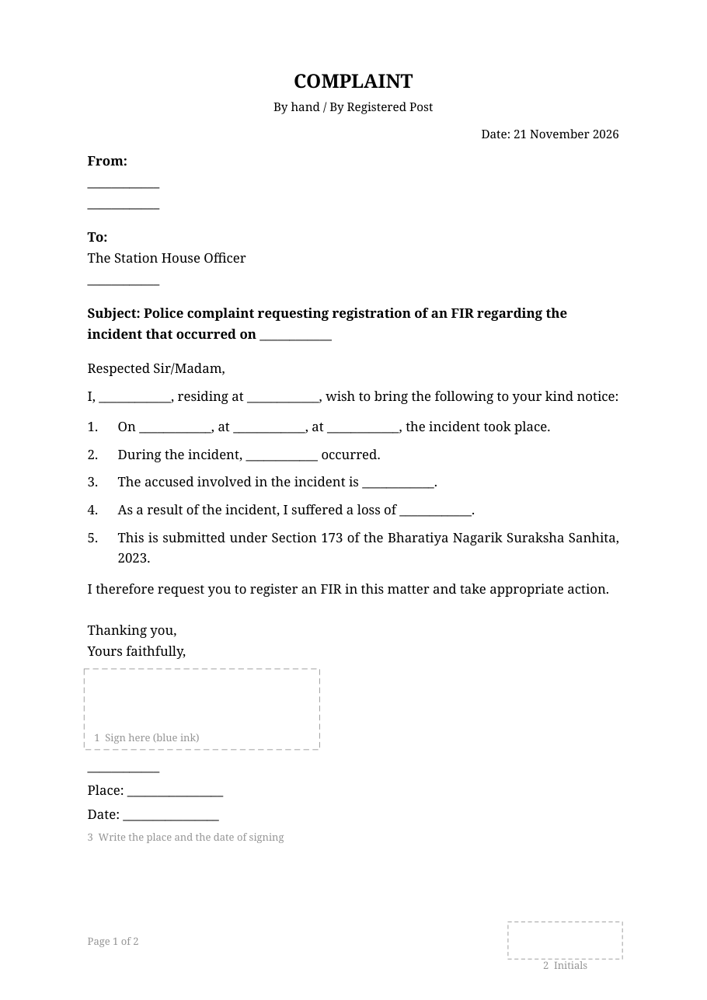
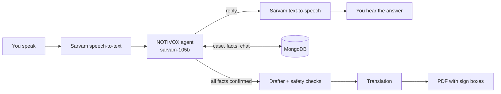

# NOTIVOX

**Speak your problem. Get a legal notice or letter you can print, sign and send.**

NOTIVOX is a voice agent for India. You talk to it in your own language, the way you would talk to a friend who
understands law. It listens to what happened, asks only for the details that are missing, and writes a properly
formatted **legal notice** or **legal letter** as a printable PDF. It then tells you exactly where to sign and how
to send it.


---

## Demo


https://github.com/user-attachments/assets/d1c602d7-5668-4c27-82bf-6a6e4175a404


A spoken conversation between a customer and NOTIVOX. Someone's motorcycle was scratched outside their house.
They talk to NOTIVOX; NOTIVOX answers in its own voice, asks only what it needs, writes a police complaint asking
the police to register an FIR, explains where to sign, and the printable PDF is downloaded.

| Step in the video | What you see |
|---|---|
| 1-2 | NOTIVOX greets you out loud and asks your language; you answer by voice |
| 3 | Tell your story by speaking |
| 4 | "I will fill the remaining details myself": NOTIVOX stops asking and leaves blank lines |
| 5-6 | Pick the document language and confirm |
| 7-8 | The letter is written, and the signing steps are spoken aloud |
| 9-10 | **Download PDF**, then the printable PDF, ready to sign and send |

### The PDF from the demo

The exact file downloaded in the video: **[NOTIVOX-demo-letter.pdf](docs/NOTIVOX-demo-letter.pdf)**

<a href="docs/NOTIVOX-demo-letter.pdf"></a>

A4, with a **Sign here** box, an **Initials** box and page numbers on every page, and a last page that explains
how to sign and send it.

---

## Why NOTIVOX

Sending a legal notice is often the first step to getting your money, your deposit or your rights back. But most
people don't know the format, can't afford a lawyer for a simple notice, or aren't comfortable writing formal
English. NOTIVOX lets anyone create one **just by talking**, in Hindi, Tamil, Telugu or any of 11 Indian languages.

## Features

- **Voice-first conversation.** NOTIVOX greets you out loud as soon as the page opens. After every reply the mic
  turns on by itself (hands-free), and you can **interrupt her mid-sentence just by speaking**, like a phone call.
  Typing is available as a backup.
- **One voice.** Every reply, in every language, is spoken in the same voice (Sarvam's `ishita_enhi_companion`),
  one reply after another, never overlapping.
- **11 languages.** English, Hindi, Bengali, Tamil, Telugu, Kannada, Malayalam, Marathi, Gujarati, Punjabi and Odia.
  The agent asks your language first and sticks to it. Switch any time by saying "speak in Tamil" (spelling
  mistakes like "engilsh" are understood).
- **Notices and letters.** 19 document types, chosen automatically from your story.
- **Fill in the rest by hand.** Say "I will fill the details myself, just write the letter" and NOTIVOX stops asking:
  anything missing becomes a blank line (`____________`) on the document, and you can also edit it on screen.
- **Your document, your language.** Pick the document's language separately from the conversation language. A
  translated copy is included together with the English copy.
- **Printable PDF.** A4 format with a "Sign here" box, an "Initials" box on every page, page numbers, and a final
  page that explains how to sign and send that particular type of document.
- **Signing guide.** Numbered markers (1 sign, 2 initials, 3 place and date, 4 attachments) on screen and in the PDF,
  also spoken aloud.
- **Edit before you download.** Every sentence of the preview can be edited in the browser.
- **Built-in safety.** Laws can only be cited from a checked list for each document type. Invented laws are
  removed, amounts are cross-checked against what you said, and threatening language is flagged.

## Document types

| Legal notices | Legal letters |
|---|---|
| Security deposit refund | Police complaint (request to register an FIR) |
| Unpaid salary / dues | RTI application |
| Defective product (consumer) | Complaint to a bank |
| Poor or failed service (consumer) | Complaint to a company / customer care |
| Online order: refund / not delivered | Complaint to a government office |
| Money lent / payment due | Other formal letter |
| Cheque bounce | |
| Builder: possession delayed | |
| Insurance claim rejected | |
| Neighbour nuisance / encroachment | |
| Defamation | |
| Reply to a legal notice you received | |
| Other legal notice | |

Each type knows which facts it needs, which laws it may cite (for example the Consumer Protection Act, 2019, the
Negotiable Instruments Act, 1881, the RERA Act, 2016, or the Bharatiya Nagarik Suraksha Sanhita, 2023), the usual
deadline, important warnings (such as the 30-day limit for cheque bounce notices) and how to send it.

## How it works



1. **Language first.** NOTIVOX greets you and asks which language you want to talk in.
2. **Your story.** You explain what happened. The agent picks the right document type and quietly collects the facts.
3. **Only what's missing.** A rule book in code tracks the required facts, so nothing important is forgotten and
   nothing is asked twice. If you prefer to fill in details yourself, say so and it moves straight on.
4. **Confirm.** The agent reads a short summary and asks for your go-ahead.
5. **Draft.** The document is written in formal Indian legal style, checked, and translated if you chose another language.
6. **Sign and send.** Download the PDF and follow the signing guide.

## Tech stack

| Part | Technology |
|---|---|
| Speech-to-text | Sarvam `saaras:v4` (code-mixed Indian speech) |
| Language model | Sarvam `sarvam-105b` |
| Voice | Sarvam `bulbul:v4-flash`, speaker `ishita_enhi_companion` |
| Translation | Sarvam `sarvam-translate:v1` |
| Backend | Python, FastAPI, Uvicorn |
| Database | MongoDB (PyMongo) |
| PDF | fpdf2 with HarfBuzz text shaping and Google Noto fonts (all Indian scripts) |
| Frontend | Plain HTML, CSS and JavaScript (no build step) |

## Getting started

### Requirements

- Python 3.10 or newer
- A [Sarvam AI](https://dashboard.sarvam.ai) API key
- A MongoDB database, for example a free [MongoDB Atlas](https://www.mongodb.com/atlas) cluster
- Chrome or Edge (for microphone and audio). **Headphones are recommended**, so the agent's voice is not picked up by your microphone

### Setup

```bash
git clone https://github.com/NitinSukthe-G/notivox.git
cd notivox

python -m venv .venv
# Windows
.venv\Scripts\activate
# macOS / Linux
source .venv/bin/activate

pip install -r requirements.txt
python -m app.setup_fonts        # one time: downloads the fonts used in the PDF
```

### Configuration

Copy `.env.example` to `.env` and fill in your own values:

| Variable | Required | Description |
|---|---|---|
| `SARVAM_API_KEY` | Yes | Your Sarvam AI API key |
| `MONGODB_URI` | Yes | Your MongoDB connection string |
| `MONGODB_DB` | No | Database name (default `notivox`) |

> Never commit your `.env` file. It is already listed in `.gitignore`.

Check your setup:

```bash
python -m app.config     # are the keys present?
python -m app.db         # can we reach MongoDB?
python -m app.sarvam     # do the AI, translation, voice and speech-to-text work?
```

### Run

```bash
uvicorn app.main:app --reload
```

Open **http://localhost:8000**. NOTIVOX greets you out loud right away. Allow the microphone when the browser asks,
then just talk.

> If you open the page and hear nothing, your browser is blocking sound until you interact with the page once:
> click anywhere (or press a key) and the greeting starts. To allow sound permanently, click the 🔒 icon next to the
> address bar, open **Site settings**, and set **Sound** to **Allow**.

## Usage tips

- Speak naturally and pause when you're done. The mic stops by itself after about 1.5 seconds of silence.
- Start talking while the agent is speaking and she stops at once and listens. You can also tap the big button.
- Turn off **Hands-free** if you prefer to tap before each answer (this also switches the microphone off between
  answers), or use **Type instead** in a noisy place.
- Say "speak in Tamil" at any time to change the language of the conversation. When asked for the language of the
  document, just name it ("Telugu") and the agent keeps talking in your conversation language.
- Say "I will fill the details myself, just write the letter" to skip the questions.
- Use the **Document language** dropdown to change the language of the document at any time, even after it is written.
- Ask "where do I sign?" at any point to hear the signing steps again.

## Other commands

| Command | What it does |
|---|---|
| `python cli.py` | Chat with NOTIVOX in the terminal |
| `python -m app.catalog` | List all document types |
| `python -m app.pdf` | Create sample PDFs in English and Hindi (no keys needed) |
| `python -m app.sarvam voices` | Try the agent's voice in all 11 languages |
| http://localhost:8000/docs | Interactive API documentation |

## API

| Method | Route | Purpose |
|---|---|---|
| `POST` | `/api/cases` | Start a new case (returns the greeting) |
| `GET` | `/api/cases` | List this device's cases |
| `GET` | `/api/cases/{id}` | Get one case (summary, conversation, draft) |
| `DELETE` | `/api/cases/{id}` | Delete a case |
| `POST` | `/api/cases/{id}/language` | Choose the conversation language |
| `POST` | `/api/cases/{id}/notice-language` | Choose the document language |
| `POST` | `/api/cases/{id}/message` | Send a typed message |
| `POST` | `/api/cases/{id}/voice` | Send a voice recording |
| `POST` | `/api/cases/{id}/draft` | Write the document |
| `PUT` | `/api/cases/{id}/draft` | Save edits to the document |
| `GET` | `/api/cases/{id}/notice.pdf` | Download the PDF |
| `POST` | `/api/tts` | Turn text into speech |
| `GET` | `/api/config`, `/api/health` | App settings and health check |

Every request identifies the browser with an anonymous device id (`X-User-Id` header). There are no accounts,
and a device can only see its own cases.

## Project structure

```
notivox/
├── app/
│   ├── main.py          # web server and API routes
│   ├── agent.py         # the conversation: language, story, missing facts, language guard
│   ├── catalog.py       # the 19 document types and their rules
│   ├── prompts.py       # instructions for the AI and fixed sentences
│   ├── notice.py        # drafting, safety checks, translation, edits
│   ├── pdf.py           # printable PDF with sign and initials boxes
│   ├── sarvam.py        # Sarvam AI client (language model, speech, voice, translation) with retries
│   ├── db.py            # MongoDB access
│   ├── config.py        # settings (reads .env)
│   └── setup_fonts.py   # downloads the Noto fonts for the PDF
├── static/
│   ├── index.html       # page structure
│   ├── app.css          # page style
│   └── app.js           # voice, conversation, preview, editing, download
├── docs/                # demo video, demo PDF and README pictures
├── cli.py               # terminal chat
├── requirements.txt
└── .env.example
```

## Privacy and cost

- Your keys stay on the server. The browser never sees them.
- Cases are stored in your own MongoDB and can be deleted.
- NOTIVOX adds no usage limits of its own; only your Sarvam credits apply.

## Limitations

- NOTIVOX drafts from the facts you give. It does not verify them.
- Speech recognition can mishear names and numbers. Always read the preview before downloading.
- The voice is only available where Sarvam supports it. If it can't speak a sentence, the reply is shown as text.
- On laptop speakers, the agent's voice can be picked up by the microphone and interrupt her. Use headphones, or
  turn off **Hands-free**.
- Browsers may block sound until the first click on the page (see "Run" above).

## Disclaimer

NOTIVOX helps people draft notices and letters from their own facts. **It is not a lawyer and does not give legal
advice.** Read the document carefully before signing it, and consult an advocate for serious matters such as
cheque bounce, defamation or criminal complaints.
