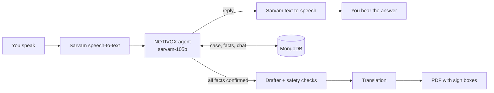

# NOTIVOX

**Speak your problem. Get a legal notice or letter you can print, sign and send.**

NOTIVOX is a voice agent for India. You talk to it in your own language, the way you would talk to a friend who
understands law. It listens to what happened, asks only for the details that are missing, and writes a properly
formatted **legal notice** or **legal letter** as a printable PDF. It then tells you exactly where to sign and how
to send it.


---

## Demo


Uploading NOTIVOX-demo.mp4…


A real conversation recorded in the running app. Someone's motorcycle was scratched outside their house. They tell
NOTIVOX what happened, NOTIVOX asks only for the missing details in its own voice, writes a police complaint
asking the police to register an FIR, explains how to sign it, and the printable PDF is downloaded.

| Step in the video | What you see |
|---|---|
| 1-2 | Tap **Start talking** and choose a language |
| 3-4 | Tell the story; NOTIVOX asks only for what is missing |
| 5 | Pick the language of the document |
| 6-7 | The letter is generated, with the signing steps spoken aloud |
| 8 | **Download PDF** |
| 9 | The printable PDF, ready to sign and send |

### The PDF from the demo

The exact file downloaded in the video: **[NOTIVOX-demo-letter.pdf](docs/NOTIVOX-demo-letter.pdf)**

<a href="docs/NOTIVOX-demo-letter.pdf"></a>

A4, with a **Sign here** box, an **Initials** box and page numbers on every page, and a last page that explains
how to sign and send it.

---

## Why NOTIVOX

Sending a legal notice is often the first step to getting your money, your deposit or your rights back. But most
people don't know the format, can't afford a lawyer for a simple notice, or aren't comfortable writing formal
English. NOTIVOX lets anyone create one **just by talking**, in Hindi, Tamil, Telugu or any of 11 Indian languages.

## Features

- **Voice-first conversation.** Tap once and just talk. The mic turns on by itself after every reply (hands-free),
  and you can interrupt the agent at any time. Typing is available as a backup.
- **11 languages.** English, Hindi, Bengali, Tamil, Telugu, Kannada, Malayalam, Marathi, Gujarati, Punjabi and Odia.
  The agent asks your language first and sticks to it. Switch any time by saying "speak in Tamil" (spelling
  mistakes like "engilsh" are understood).
- **Notices and letters.** 19 document types, chosen automatically from your story.
- **Your document, your language.** Pick the document's language separately from the conversation language. A
  translated copy is included together with the English copy.
- **Printable PDF.** A4 format with a "Sign here" box, an "Initials" box on every page, page numbers, and a final
  page that explains how to sign and send that particular type of document.
- **Signing guide.** Numbered markers (1 sign, 2 initials, 3 place and date, 4 attachments) on screen and in the PDF,
  also spoken aloud.
- **Edit before you download.** Every sentence of the preview can be edited in the browser.
- **Built-in safety.** Laws can only be cited from a checked list for each document type. Invented laws are
  removed, amounts are cross-checked against what you said, and threatening language is flagged.

## Document types

| Legal notices | Legal letters |
|---|---|
| Security deposit refund | Police complaint (request to register an FIR) |
| Unpaid salary / dues | RTI application |
| Defective product (consumer) | Complaint to a bank |
| Poor or failed service (consumer) | Complaint to a company / customer care |
| Online order: refund / not delivered | Complaint to a government office |
| Money lent / payment due | Other formal letter |
| Cheque bounce | |
| Builder: possession delayed | |
| Insurance claim rejected | |
| Neighbour nuisance / encroachment | |
| Defamation | |
| Reply to a legal notice you received | |
| Other legal notice | |

Each type knows which facts it needs, which laws it may cite (for example the Consumer Protection Act, 2019, the
Negotiable Instruments Act, 1881, the RERA Act, 2016, or the Bharatiya Nagarik Suraksha Sanhita, 2023), the usual
deadline, important warnings (such as the 30-day limit for cheque bounce notices) and how to send it.

## How it works



1. **Language first.** NOTIVOX asks which language you want to talk in.
2. **Your story.** You explain what happened. The agent picks the right document type and quietly collects the facts.
3. **Only what's missing.** A rule book in code tracks the required facts, so nothing important is forgotten and
   nothing is asked twice.
4. **Confirm.** The agent reads a short summary and asks for your go-ahead.
5. **Draft.** The document is written in formal Indian legal style, checked, and translated if you chose another language.
6. **Sign and send.** Download the PDF and follow the signing guide.

## Tech stack

| Part | Technology |
|---|---|
| Speech-to-text | Sarvam `saaras:v4` (code-mixed Indian speech) |
| Language model | Sarvam `sarvam-105b` |
| Voice | Sarvam `bulbul:v4-flash` |
| Translation | Sarvam `sarvam-translate:v1` |
| Backend | Python, FastAPI, Uvicorn |
| Database | MongoDB (PyMongo) |
| PDF | fpdf2 with HarfBuzz text shaping and Google Noto fonts (all Indian scripts) |
| Frontend | Plain HTML, CSS and JavaScript (no build step) |

## Getting started

### Requirements

- Python 3.10 or newer
- A [Sarvam AI](https://dashboard.sarvam.ai) API key
- A MongoDB database, for example a free [MongoDB Atlas](https://www.mongodb.com/atlas) cluster
- Chrome or Edge (for microphone and audio)

### Setup

```bash
git clone https://github.com/<your-username>/notivox.git
cd notivox

python -m venv .venv
# Windows
.venv\Scripts\activate
# macOS / Linux
source .venv/bin/activate

pip install -r requirements.txt
python -m app.setup_fonts        # one time: downloads the fonts used in the PDF
```

### Configuration

Copy `.env.example` to `.env` and fill in your own values:

| Variable | Required | Description |
|---|---|---|
| `SARVAM_API_KEY` | Yes | Your Sarvam AI API key |
| `MONGODB_URI` | Yes | Your MongoDB connection string |
| `MONGODB_DB` | No | Database name (default `notivox`) |
| `NOTIVOX_VOICE_CAP_INR` | No | Total spend (₹) after which voice is paused (default 80) |
| `NOTIVOX_HARD_CAP_INR` | No | Total spend (₹) after which the AI is paused (default 95) |
| `NOTIVOX_DAILY_DEVICE_LIMIT` | No | Sarvam calls allowed per device per day (default 80) |

> Never commit your `.env` file. It is already listed in `.gitignore`.

Check your setup:

```bash
python -m app.config     # are the keys present?
python -m app.db         # can we reach MongoDB?
python -m app.sarvam     # do the AI, translation, voice and speech-to-text work?
```

### Run

```bash
uvicorn app.main:app --reload
```

Open **http://localhost:8000**, tap **Start talking**, allow the microphone, and speak.

## Usage tips

- Speak naturally and pause when you're done. The mic stops by itself after about 1.5 seconds of silence.
- Tap the big button while the agent is speaking to interrupt her.
- Turn off **Hands-free** if you prefer to tap before each answer, or use **Type instead** in a noisy place.
- Use the **Document language** dropdown to change the language of the document at any time, even after it is written.
- Ask "where do I sign?" at any point to hear the signing steps again.

## Other commands

| Command | What it does |
|---|---|
| `python cli.py` | Chat with NOTIVOX in the terminal |
| `python -m app.catalog` | List all document types |
| `python -m app.pdf` | Create sample PDFs in English and Hindi (no keys needed) |
| `python -m app.sarvam voices` | Try the agent's voice in all 11 languages |
| http://localhost:8000/docs | Interactive API documentation |

## API

| Method | Route | Purpose |
|---|---|---|
| `POST` | `/api/cases` | Start a new case (returns the greeting) |
| `GET` | `/api/cases` | List this device's cases |
| `GET` | `/api/cases/{id}` | Get one case (summary, conversation, draft) |
| `DELETE` | `/api/cases/{id}` | Delete a case |
| `POST` | `/api/cases/{id}/language` | Choose the conversation language |
| `POST` | `/api/cases/{id}/notice-language` | Choose the document language |
| `POST` | `/api/cases/{id}/message` | Send a typed message |
| `POST` | `/api/cases/{id}/voice` | Send a voice recording |
| `POST` | `/api/cases/{id}/draft` | Write the document |
| `PUT` | `/api/cases/{id}/draft` | Save edits to the document |
| `GET` | `/api/cases/{id}/notice.pdf` | Download the PDF |
| `POST` | `/api/tts` | Turn text into speech |
| `GET` | `/api/config`, `/api/health` | App settings and health check |

Every request identifies the browser with an anonymous device id (`X-User-Id` header). There are no accounts,
and a device can only see its own cases.

## Project structure

```
notivox/
├── app/
│   ├── main.py          # web server and API routes
│   ├── agent.py         # the conversation: language, story, missing facts, language guard
│   ├── catalog.py       # the 19 document types and their rules
│   ├── prompts.py       # instructions for the AI and fixed sentences
│   ├── notice.py        # drafting, safety checks, translation, edits
│   ├── pdf.py           # printable PDF with sign and initials boxes
│   ├── sarvam.py        # Sarvam AI client with retries and spending limits
│   ├── db.py            # MongoDB access
│   ├── config.py        # settings (reads .env)
│   └── setup_fonts.py   # downloads the Noto fonts for the PDF
├── static/
│   ├── index.html       # page structure
│   ├── app.css          # page style
│   └── app.js           # voice, conversation, preview, editing, download
├── cli.py               # terminal chat
├── requirements.txt
└── .env.example
```

## Privacy and cost

- Your keys stay on the server. The browser never sees them.
- Cases are stored in your own MongoDB and can be deleted.
- Spending limits stop Sarvam calls before your credit runs out, and each device has a daily limit.

## Limitations

- NOTIVOX drafts from the facts you give. It does not verify them.
- Speech recognition can mishear names and numbers. Always read the preview before downloading.
- The voice is only available where Sarvam supports it. If it can't speak a sentence, the reply is shown as text.

## Disclaimer

NOTIVOX helps people draft notices and letters from their own facts. **It is not a lawyer and does not give legal
advice.** Read the document carefully before signing it, and consult an advocate for serious matters such as
cheque bounce, defamation or criminal complaints.
